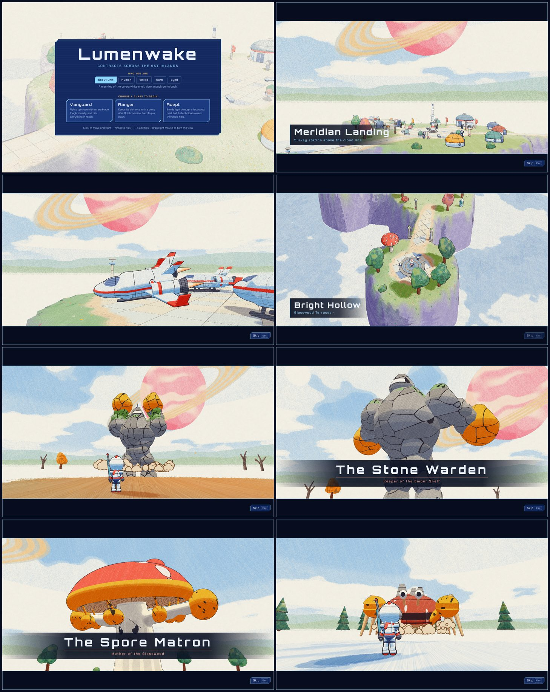
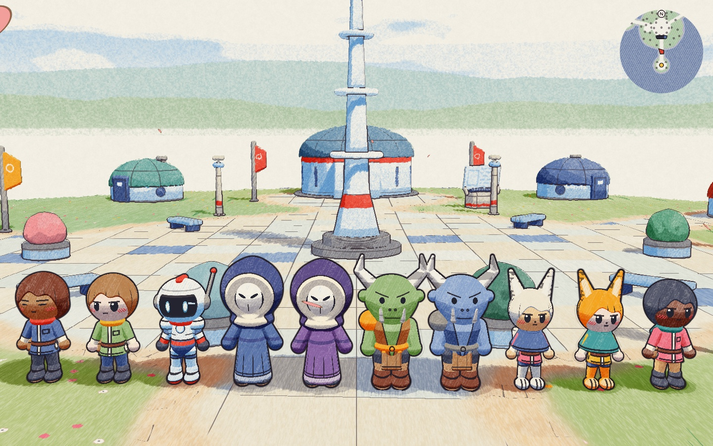
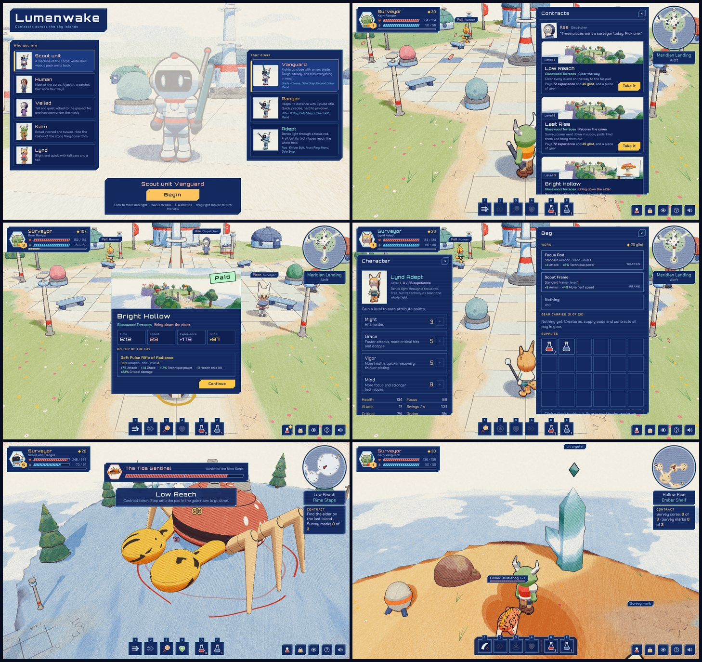
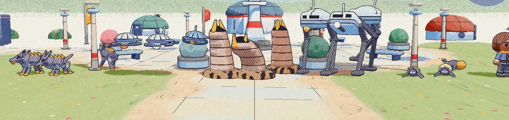
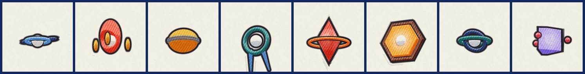

# Lumenwake

A mission game drawn by shaders. You arrive by shuttle at a floating town, Meridian Landing. Choose who you are and pick a class, take a contract from the dispatcher, step on the pad, and fight across a string of sky islands that is generated from the contract's seed. Bring back gear, get paid, take the next one.

**Play it: https://kevintngo.github.io/lumenwake/** (a desktop browser with WebGL 2; `./publish.sh` builds and republishes it).

"Lumenwake" is a working title.











## What is in it

- **First steps.** A new surveyor is walked through the first hour by doing it: to the dispatcher, a first contract laid out by hand (First Light), a first fight, a first piece of gear, a jump, the lumen's burst, a survey mark, a gentler elder, and home to spend points and feed the lumen. One line at a time on a card over the hotbar, a chevron over the thing in the world (an arrow at the edge of the picture when it is out of sight), and a ring round the button to press, which follows you into the menu. Each step ends when the thing is done. It can be skipped, and started again from the pause menu.
- **A town.** A paved square round a survey beacon, the contract hall, a market, homes, a landing field, an overlook and the gate terrace, with crew who walk their rounds and have something to say.
- **Three classes.** Vanguard (arc blade), Ranger (pulse rifle), Adept (focus rod). A class sets starting attributes, the family of weapon it can wield and the four abilities on its bar.
- **A three-step attack chain.** Attacks come in threes and the third is the heavy one: a blade's third cut takes everything in front, a rifle's third shot hits harder, a rod's third bursts.
- **Gear.** Weapon, frame and unit. Each piece is a base type, an item level, a rarity (Standard, Tuned, Rare, Prime) and rolled affixes; a Prime piece also lends ranks of a talent. Every base has its own shape in the hand, on the shoulders or on the back, and its tile in the menu is drawn from that same shape. It drops from creatures, supply pods and bosses, every contract pays one piece, and the quartermaster buys and sells it.
- **Contracts.** Three on the board at a time: clear the way, recover survey cores, or bring down the boss of the place. Four places (Glasswood Terraces, Ember Shelf, The Hush, Rime Steps), each with its own look, creatures and boss.
- **Generated missions.** A contract's seed gives the layout (islands and bridges), what waits on each island (bought from a budget that grows with the contract's level and with how deep the island lies), where the supply pods are, and how the fights roll.
- **Bosses.** The Stone Warden, the Spore Matron and the Tide Sentinel: several moves each, reinforcements, and faster once past half health.

- **Five peoples.** Scout units, humans, the veiled, karn and lynd: a build, a head and a way of dressing each, on one set of joints. The crew is a mix of them, and the hero can be any of them in any class.
- **Elders the size of buildings.** The Stone Warden, the Spore Matron and the Tide Sentinel are colossi eight to thirteen metres tall, each with its own shape, moves and a volley it throws at where you stand. The play camera stands back for them.
- **Eleven kinds of creature.** The six small ones, plus a pack hound that springs, a watcher drone that keeps its distance, a delver that comes up under you, a strider that fires down a line, and a sparkmite that bursts. Each place has its own mix.
- **A lumen at your shoulder.** A small light that follows you, puts a bolt into whatever you are fighting, and stores up a burst (G). Feed it what creatures drop: three tempers grow with what it eats, and at levels 5 and 12 it takes a new shape by the strongest of them. Eight kinds in all, each with a burst of its own.
- **A jump.** Space jumps. Some side islands have a bridge broken in the middle, some have no bridge at all but a row of stepping stones, and big islands may have a terrace with a supply pod on it: all of them need a jump. A blow that runs along the ground (a slam, a delver coming up) can be jumped too. Miss, and you are hauled back from the cloud a little worse for it.
- **Things to find.** Side islands off the main way, and on them survey marks (each adds to the pay; all three make the prize a better piece), a beacon that puts everything left on the map, lit crystals that lend a boon until you are lifted out, and lost cargo with something sitting on it.
- **Pictures drawn by the game.** Every portrait and scene in the interface is a frame from the game's own renderer: the peoples and classes on the select screen, the crew when they speak, the elders on their bar and on hunt contracts, a view of each place on the board and the report. The hero's own portrait is taken while you play, so it is always who you chose. In the menu the hero and the lumen stand alive on nothing: they breathe, and turn when dragged (or with the arrow keys).
- **One menu, and a pause menu.** Character, Gear, Lumen, Contract and Guide are tabs of one window that holds the game while it is open. Esc opens the pause menu: settings for display, sound, controls and accessibility (text size, reduced motion, high contrast, skip cinematics), kept between visits.
- **Pads that show the way.** The pad that sends you down, and the one that lifts you out, keep lifting rings of light off themselves: slow and faint while cold, quick and bright once they will take you.
- **Lettering coloured by what it names.** People, places, numbers, experience, glint, good and bad, creatures, each class and each kind of contract have a colour of their own, all at 4.5:1 or better on every ground they sit on (the table is at the end of `src/ui/ui.css`).
- **Music that knows where you are.** Every area has its own key, tempo and instruments (the town in D major with piano and violin, Glasswood bright and high, Ember low on cello, the Hush on slow glass tones, Rime thin and still), all made in the browser with no audio files. A fight brings in a soft drum and low strings; an elder moves the area to a darker mode with a tolling bell; low health thins the music out; a cinematic holds it to a quiet pad. One row per area in `AREAS` in `src/audio/audio.js`.
- **Cinematics.** Arriving at the town, dropping onto a contract, an elder waking, an elder falling. All of them can be skipped (Esc, Enter, Space or the Skip button), and none is needed to play: add `?nocine` to the address to go without.

## Run it

Any static file server works; there is no build step and nothing to install.

```bash
python3 -m http.server 8080
```

Then open `http://localhost:8080`. Add `?touch` to see the phone layout on a desktop.

Progress is not saved yet: each visit starts a new journey in the town.

## Controls

| Input | Action |
| --- | --- |
| Left click | Walk to a spot, attack a creature, talk to someone. Hold to keep walking. |
| W A S D | Walk by hand |
| 1 2 3 4 | Abilities (aimed at the target, or at the cursor) |
| Space | Jump |
| F / Tab | Attack the nearest creature or talk to someone near / pick the next creature |
| R / T | Drink a Red Tonic / Blue Draught |
| Right drag, Q / E, wheel | Turn, tilt and zoom the view |
| G | Let the lumen's burst go |
| C / B / L / J / H | The menu, on its Character / Gear / Lumen / Contract / Guide tab (Q and E change tab) |
| M / V | Sound on or off / the camera's buttons |
| Esc | Close what is open; otherwise the pause menu and settings |

## How the code is laid out

Three walls. Content is data, the simulation is rules, and the app draws and listens. The simulation never calls the renderer, the camera or the interface: it announces what happened on an event bus (`feel`, `fade`, `world:changed`, `shot:launch`, `pickup`, ...) and the app reacts.

```
src/
  content/      data only: what exists
    classes.js      classes and weapon families
    abilities.js    what goes on the bar (numbers and the kind of effect)
    gear.js         bases (each with the look it has in the hand), rarities, affixes, how stats read
    tutorial.js     the first steps, in order: what each says, points at and waits for
    creatures.js    creatures and bosses: numbers, moves, drops, encounter cost
    themes.js       the places: ground, plants, creatures, boss, hour
    town.js         the town: rooms, paving, fixtures, crew
    items.js        flasks, materials, recipes
    talents.js      talents
  sim/          rules: no DOM, no GL, no camera
    rng.js          the one seeded source of dice
    stats.js        every stat is a base run through one pipeline of modifiers
    items.js        rolling, naming, pricing and reading gear
    encounters.js   what waits on each island, bought from a budget
    systems/        player, ai, specials (creature moves), hazards, combat,
                    skills (ability effects), loot, spawner, missions, crew
  world/        where things are
    layout.js       rooms and bridges from a seed, or from the town's data
    nav.js          where a body may stand
    zone.js         a layout turned into what the renderer and the rules read
    world.js        one zone at a time
    props.js        every piece of scenery, with the shader that draws it
  gfx/          the renderer (raw WebGL2, no libraries)
  app/          the composition root: game loop, controls, camera view, effects,
                the first steps' runner, the portraits and the gear tiles
  ui/           HUD, windows, touch controls
  audio/        synthesized sound and music
  core/         events, input, maths, noise
```

### Cinematics

A cinematic is a row in `src/content/cinematics.js`: a list of shots, each with a camera, what the cast does, cues for sound and effects, and lettering. The camera is described as an orbit about something (the hero, the elder, a room), so one sequence works on any island a contract rolls, and distances can be given in heights of a cast member so one shot fits every size of elder. `TRIGGERS` in the same file says which event starts which sequence.

`src/app/cinema.js` is the director that plays them. The rules never know a cinematic exists: the game loop asks the director how fast the world may run (0 holds it still, a fraction is slow motion) and whether the hero's controls are held. Whatever a sequence leaves behind is applied in one place (`finish`), so skipping in the first second leaves the game exactly as watching to the end would. `src/ui/cinema.js` draws the bars, cards, captions and the Skip button.

## Adding things

| To add | Do this |
| --- | --- |
| A class | A row in `content/classes.js`: attributes, weapon family, four ability ids, a colour. |
| An ability | A row in `content/abilities.js` using an existing effect (`arc`, `ring`, `bolt`, `volley`, `heal`, `dash`). A new kind of effect is one function in `sim/systems/skills.js`. |
| A gear base, affix or rarity | A row in `content/gear.js`. Anything in the stat list can be rolled. A base's `look` picks its shape in `gfx/glsl/held.js`, which the hero and the menu's tiles both draw from; a new shape is a branch there. |
| A step of the first steps | A row in `content/tutorial.js`: its line, what it points at, the control to ring, and the event or test that ends it. |
| A stat | A line in `derive` in `sim/stats.js` and its name in `STAT_TEXT`. |
| A creature | A row in `content/creatures.js` (with a `cost`) and an entry in a theme's table. A new shape: an archetype in `gfx/archetypes/`. |
| A boss | A creature row with `boss: true` and a list of `specials`; name it as a theme's `boss`. For a colossus add `giant: true`, `turn`, `fall` and `hitY`, and model it at its true size as the three in `gfx/archetypes/colossi.js` are, with poses for emerge, roar and fall. |
| A kind of lumen | A row in `content/companions.js` (its stage, the temper that leads to it, its burst) and a shape for it in `gfx/archetypes/lumen.js`. A new food is a row in `FOODS`. |
| Something to find | A row in `content/sites.js` (the landmark, its reach, its marker's colour), a line in `world/layout.js` saying which islands get it, and a branch in `sim/systems/sites.js` for what it does. |
| A picture for the interface | Add a shot to `tools/art-studio.js` and run it: it draws with the game's renderer into `static/art/`. |
| A people | A row in `content/peoples.js` and a branch for its `index` in `gfx/archetypes/humanoid.js` (head, build, clothes). Give it to someone in `content/town.js` with `people:`. |
| A cinematic | A row in `content/cinematics.js`, and a row in `TRIGGERS` if an event should start it. |
| A creature move | An entry in `SPECIALS` in `sim/systems/specials.js`. |
| A place | A row in `content/themes.js`. |
| A building or prop | `registerProp` in `world/props.js`, then place it in `content/town.js` or a theme's table. |

## How it is drawn

The picture is Brushwild's renderer: one raymarch decides what is where, and a final pass draws it as pencil lays and pen lines on paper. Here it leans toward cel shading (flat stepped fills, hard-edged shade, a steady dark line) through one dial, `CEL` in `src/gfx/glsl/pencil.js`. One limit to know about: only one prop can be drawn in each 4 by 4 cell of ground, so fixtures placed by hand must not share a cell.

## Not done yet

- No saving, no tests in the repo, no co-op.
- Six of the eleven ordinary creatures still use Brushwild's shapes.
- The elders fill much of the picture and are drawn at full resolution: their cost on a slow GPU or a phone has not been measured.
- None of the sound has been listened to: the music and effects are checked by a test that counts what is scheduled (keys, tempo, layers, voice limits), and in a browser only for running without errors.
- The first steps have been played end to end by a test bot that presses only what they ring, not by a new player; the game has not been tried on a real phone.
- The simulation still steps with the frame's time, so two runs repeat exactly only at a fixed frame time.
- Talent logic still lives beside its data in `content/talents.js`.
- The share picture and icons in `static/` are still Brushwild's.

## License

MIT. See [LICENSE](LICENSE). Lettering: Chakra Petch and Orbitron from Google Fonts (SIL Open Font License), loaded from Google's servers.
